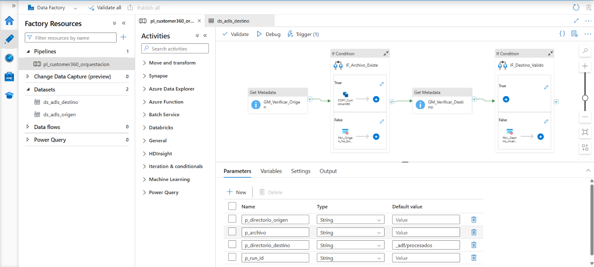
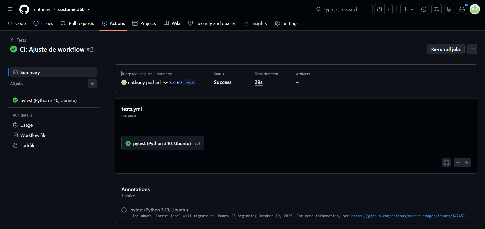
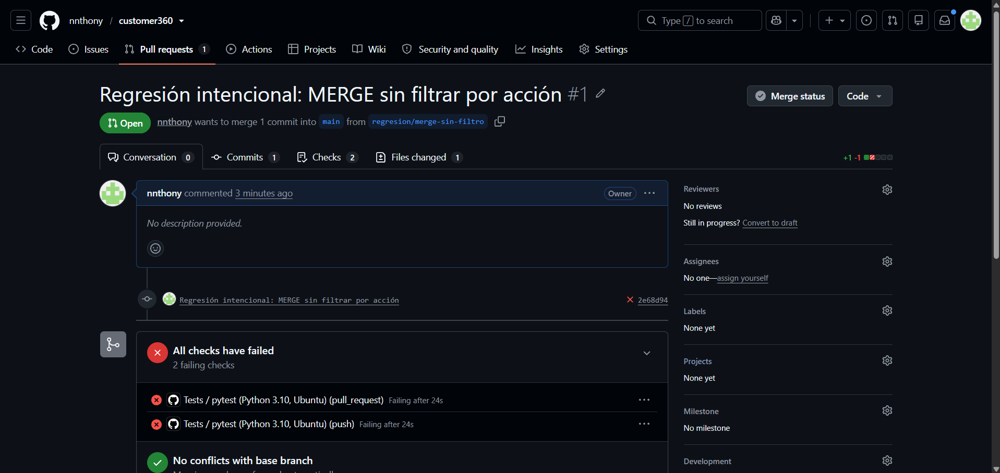
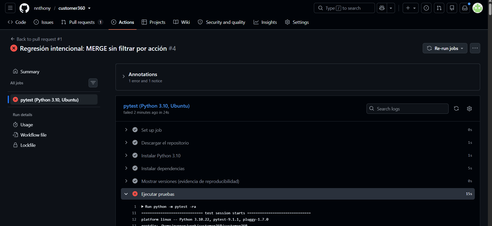

# Customer 360 — Pipeline de datos incremental, verificable y publicado en Azure


Pipeline construido con **Python + DuckDB + Parquet + pytest** sobre la
arquitectura medallón (Bronze → Silver → Gold). A partir de cuatro fuentes
(clientes, servicios, pagos y contactos) genera una tabla **Customer 360** con
una fila por cliente para seleccionar una audiencia objetivo.

- Los **pagos se procesan de forma incremental**: reejecutar un lote no cambia
  el resultado, una versión antigua nunca pisa a una corrección y un fallo a
  mitad del proceso no corrompe el estado.
- El resultado se **publica en Azure Data Lake Storage Gen2** con identidad de
  Microsoft Entra ID (**sin claves ni secretos en el código**), verificando cada
  archivo por SHA-256 y cerrando con un manifiesto.
- El acceso al Data Lake se controla con **RBAC y ACL**, y se demostró con una
  identidad de servicio en cuatro escenarios.
- **Azure Data Factory orquesta** los archivos publicados: verifica que existan,
  los copia a una zona de procesamiento por ejecución, valida el resultado y
  falla de forma visible si algo no se cumple. Accede con **identidad
  administrada**, sin ninguna credencial.
- Cada `push` y cada pull request ejecuta las pruebas en GitHub Actions, **sin
  depender de Azure**.

> Todos los datos del proyecto son **sintéticos**. No contiene datos reales de
> clientes ni de ninguna empresa.

---

## Índice

1. [Inicio rápido](#inicio-rápido)
2. [Arquitectura](#arquitectura)
3. [Estructura del proyecto](#estructura-del-proyecto)
4. [Ejecución local](#ejecución-local)
5. [Capas y reglas de calidad](#capas-y-reglas-de-calidad)
6. [Customer 360 (Gold)](#customer-360-gold)
7. [Carga incremental de pagos](#carga-incremental-de-pagos)
8. [Transacción, recuperación y auditoría](#transacción-recuperación-y-auditoría)
9. [Data Lake en Azure (ADLS Gen2)](#data-lake-en-azure-adls-gen2)
10. [Autenticación sin secretos](#autenticación-sin-secretos)
11. [Publicación en el Data Lake](#publicación-en-el-data-lake)
12. [Control de acceso: RBAC vs ACL](#control-de-acceso-rbac-vs-acl)
13. [Manejo de secretos](#manejo-de-secretos)
14. [Costos](#costos)
15. [Orquestación con Azure Data Factory](#orquestación-con-azure-data-factory)
16. [Pruebas](#pruebas)
17. [Integración continua](#integración-continua)
18. [Docker](#docker)
19. [Qué se versiona y qué no](#qué-se-versiona-y-qué-no)
20. [Decisiones de diseño](#decisiones-de-diseño)
21. [Respuesta a observaciones anteriores](#respuesta-a-observaciones-anteriores)
22. [Limitaciones y siguientes pasos](#limitaciones-y-siguientes-pasos)

---

## Inicio rápido

**Requisitos:** Python **3.10** y Git. Para la parte local **no se necesita
Azure**: las pruebas usan un Data Lake simulado.

**Windows (PowerShell):**

```powershell
git clone https://github.com/nnthony/customer360.git
cd customer360
python -m venv .venv
.\.venv\Scripts\Activate.ps1
python -m pip install --upgrade pip
python -m pip install -r requirements.txt
python -m pytest -ra
```

**Linux / macOS:**

```bash
git clone https://github.com/nnthony/customer360.git
cd customer360
python3.10 -m venv .venv
source .venv/bin/activate
python -m pip install --upgrade pip
python -m pip install -r requirements.txt
python -m pytest -ra
```

Resultado esperado: **`153 passed, 1 skipped`**. La prueba saltada es la de
integración contra Azure real, que solo corre cuando se activa a propósito (ver
[Pruebas](#pruebas)). `-ra` la muestra con su motivo, para que un salto nunca
pase desapercibido.

### Dependencias

`requirements.txt` contiene **solo las dependencias directas**, con versión fija:

```
duckdb==1.5.6
pytest==9.1.1
azure-identity==1.26.0
azure-storage-file-datalake==12.26.0
```

- `azure-identity` aporta `DefaultAzureCredential` (autenticación con Entra ID).
- `azure-storage-file-datalake` es el SDK propio de ADLS Gen2: trabaja con
  **directorios reales** y **ACL**, que el SDK de Blob no expone.

No se usa `pip freeze`: arrastraría dependencias propias del sistema operativo
(por ejemplo, `colorama` solo en Windows) y el archivo describiría una máquina
concreta y no el proyecto.

---

## Arquitectura

```
data/raw/                     (entrada sintética, versionada en Git)
 ├── clientes.csv ─┐
 ├── servicios.csv ┼── ingest.py ──▶ bronze/*.csv ──transform.py──▶ silver/*.parquet ─┐
 ├── contactos.csv ┘                (copia exacta + manifiesto sha256)  (validado)      │
 └── pagos/                                                                              │
     ├── pagos_inicial.csv ──┐                                                           │
     ├── pagos_lote_001.csv ─┼── incremental.py ──▶ bronze/pagos/<batch_id>.csv          │
     └── pagos_lote_002.csv ─┘                     (append-only, nunca se sobrescribe)  │
                                                                                         ▼
                 ┌──────────────── data/customer360.duckdb (ESTADO OFICIAL) ────────────────┐
   BEGIN ───────▶│ silver_clientes · silver_servicios · silver_contactos  (carga completa)  │
                 │ silver_pagos (MERGE incremental) · silver_pagos_rechazados               │
                 │ control_lotes · gold_customer360 · auditoria_ejecuciones (SUCCESS)       │
   COMMIT ──────▶└─────────────────────────────────────────────────────────────────────────┘
                                            │
                                            ▼  (después del COMMIT)
                              data/gold/customer360.parquet / .csv   (copias derivadas)
                                            │
                                            ▼  --publicar (solo si TODOS los lotes terminaron en SUCCESS)
                 ┌──────────── Azure Data Lake Storage Gen2 · contenedor customer360 ────────────┐
                 │ bronze/…/*.csv · silver/<tabla>/<tabla>.parquet · gold/customer360/*.parquet │
                 │ _manifiestos/ejecucion_<id>.json · _manifiestos/ultimo.json (SIEMPRE al final)│
                 └───────────────────────────────────────────────────────────────────────────────┘
                   cada archivo: subir → descargar → comparar SHA-256   ·   identidad: Entra ID
                                            │
                                            ▼  Azure Data Factory (identidad administrada)
                 pl_customer360_orquestacion: verificar origen → copiar → verificar destino → Fail si algo no cumple
                                            │
                                            ▼
                              customer360/_adf/procesados/<run_id>/<archivo>

   Si un lote falla: ROLLBACK → auditoría FAILED → NO se publica nada.
```

**Principios:**

- **Bronze** conserva la entrada tal cual llegó, sin interpretar.
- **Silver** valida, tipa y deduplica según reglas documentadas. Ninguna fila
  se borra en silencio: termina como válida o como rechazada, con su motivo.
- **Gold** aplica la lógica de negocio y se reconstruye completo desde Silver.
- La **base DuckDB es la fuente oficial**. Los Parquet/CSV de `data/gold/` son
  copias que se pueden regenerar en cualquier momento.
- El **Data Lake recibe solo resultados confirmados** (*Write-Audit-Publish*):
  primero `COMMIT` local, después publicación. Si la publicación falla, el
  estado local sigue correcto y se puede volver a publicar.

---

## Estructura del proyecto

```
customer360/
├── .github/workflows/tests.yml   # CI: pytest + Docker en cada push y pull request
├── Dockerfile                    # imagen que ejecuta las pruebas
├── .dockerignore
├── adf/                          # definiciones exportadas de Azure Data Factory (Semana 7)
│   ├── linkedService/            # ls_adls_customer360.json (identidad administrada, sin credenciales)
│   ├── dataset/                  # ds_adls_origen.json, ds_adls_destino.json (parametrizados)
│   ├── pipeline/                 # pl_customer360_orquestacion.json
│   ├── trigger/                  # tr_customer360_una_vez.json
│   └── evidencias/               # capturas y ejecuciones_pipeline.csv
├── data/
│   └── raw/                      # ENTRADA sintética (versionada)
│       ├── clientes.csv, servicios.csv, contactos.csv, pagos.csv
│       └── pagos/                # lotes incrementales
│           ├── pagos_inicial.csv
│           ├── pagos_lote_001.csv
│           └── pagos_lote_002.csv
├── docs/evidencia/               # capturas de CI, PR de regresión, Azure
├── infra/
│   ├── crear_datalake.ps1        # crea grupo, cuenta ADLS Gen2, contenedor y rol de datos
│   ├── eliminar_datalake.ps1     # borra TODO el laboratorio (pide confirmación)
│   ├── probar_permisos.py        # qué puede hacer la identidad actual (demo RBAC/ACL)
│   └── verificar_copias_adf.py   # compara por SHA-256 las copias de ADF con sus originales
├── sql/
│   ├── customer360.sql           # lógica de Gold (no contiene rutas)
│   ├── schema.sql                # tablas del estado persistente
│   ├── clasificar_pagos.sql      # decide INSERT / UPDATE / IGNORE / CONFLICT
│   └── merge_pagos.sql           # ejecuta lo decidido
├── src/
│   ├── ingest.py                 # Raw → Bronze
│   ├── transform.py              # Bronze → Silver (reglas de calidad)
│   ├── incremental.py            # lotes de pagos: Bronze, preparación, clasificación, MERGE
│   ├── pipeline_incremental.py   # ★ PUNTO DE ENTRADA OFICIAL (incluye --publicar)
│   ├── azure_storage.py          # acceso a ADLS Gen2: subir, listar, descargar, SHA-256
│   ├── publicar.py               # qué se publica, en qué orden y el manifiesto
│   └── pipeline.py               # pipeline de carga completa (Semana 3, referencia)
├── tests/
│   ├── fixtures/pagos_lote_conflicto.csv
│   ├── test_aceptacion.py        # las 8 pruebas de aceptación (Semana 4)
│   ├── test_calidad.py           # prueba de reconciliación integral
│   ├── test_azure_storage.py     # módulo de Azure con un Data Lake simulado
│   ├── test_publicar.py          # publicación y manifiesto con el Data Lake simulado
│   ├── test_integracion_azure.py # contra Azure real (solo si se activa)
│   └── test_*.py                 # pruebas de desarrollo por capa
├── pytest.ini
└── requirements.txt
```

`pipeline.py` es el orquestador de carga completa de la Semana 3. Se conserva
como referencia y sigue cubierto por sus pruebas, pero **el punto de entrada
oficial es `pipeline_incremental.py`**.

---

## Ejecución local

### Procesar la carga inicial y los lotes

```powershell
python -m src.pipeline_incremental --fecha-corte 2026-09-30 --lote data/raw/pagos/pagos_inicial.csv data/raw/pagos/pagos_lote_001.csv data/raw/pagos/pagos_lote_002.csv
```

Los lotes se aplican en orden alfabético aunque se pasen desordenados. Salida:

```
[inicial  ] SUCCESS  entrada= 30  ins= 30  upd=  0  ign=  0  rech=  0  |  gold 10 filas, elegibles=5
[lote_001 ] SUCCESS  entrada=  8  ins=  2  upd=  2  ign=  3  rech=  1  |  gold 10 filas, elegibles=5
[lote_002 ] SUCCESS  entrada=  4  ins=  1  upd=  1  ign=  2  rech=  0  |  gold 10 filas, elegibles=5
```

### Reejecutar un lote (idempotencia)

```powershell
python -m src.pipeline_incremental --fecha-corte 2026-09-30 --lote data/raw/pagos/pagos_lote_002.csv
```

```
[lote_002 ] SUCCESS  entrada=  4  ins=  0  upd=  0  ign=  4  rech=  0  |  gold 10 filas, elegibles=5
```

### Simular un fallo antes del COMMIT

```powershell
python -m src.pipeline_incremental --fecha-corte 2026-09-30 --lote data/raw/pagos/pagos_lote_002.csv --simular-fallo
```

El proceso termina con código de salida `1`, el estado queda intacto y la
auditoría registra la ejecución como `FAILED`.

### Opciones

| Opción | Descripción |
|---|---|
| `--fecha-corte YYYY-MM-DD` | **Obligatoria.** Referencia para las ventanas de 30 y 90 días |
| `--lote <csv> [<csv> ...]` | Uno o más lotes de pagos |
| `--base-dir <carpeta>` | Carpeta de datos (por defecto `data/`) |
| `--publicar` | Al terminar **todos** los lotes en SUCCESS, publica en el Data Lake (ver [Publicación](#publicación-en-el-data-lake)) |
| `--simular-fallo` | Lanza un error justo antes del COMMIT |
| `--debug` | Muestra el traceback completo en caso de error |

### Consultar el estado

```powershell
python -c "import duckdb; duckdb.connect('data/customer360.duckdb', read_only=True).sql('SELECT * FROM auditoria_ejecuciones ORDER BY fecha_inicio').show()"
python -c "import duckdb; duckdb.connect('data/customer360.duckdb', read_only=True).sql('SELECT * FROM gold_customer360').show()"
```

---

## Capas y reglas de calidad

### Bronze

- Copia **byte a byte** de la entrada. Todo se lee como texto (`all_varchar`):
  un valor raro no debe romper la lectura.
- **Contrato de entrada:** se valida que existan los archivos y que sus columnas
  sean exactamente las esperadas, **antes** de escribir nada.
- Las tablas de carga completa generan un `_manifest.json` con filas, fecha de
  ingesta y **sha256** por archivo.
- Los lotes de pagos son **append-only**: `bronze/pagos/<batch_id>.csv` nunca se
  sobrescribe. Reaplicar el mismo lote está permitido; reutilizar un `batch_id`
  con otro contenido es un error.

### Silver

Cada fila recibe un `motivo_rechazo` (el **primero** que falle, en el orden de
la tabla). Las válidas se publican tipadas; las rechazadas se guardan **con su
valor original en texto**, para poder diagnosticar qué llegó mal.

| Tabla | Regla | Motivo |
|---|---|---|
| Todas | ID nulo o fuera de formato (`C###`, `S###`, `P###`, `T###`) | `id_invalido` |
| Servicios, pagos, contactos | `cliente_id` no existe entre los clientes **válidos** | `cliente_inexistente` |
| Clientes, pagos, contactos | Fecha no convertible a `DATE` | `fecha_invalida` |
| Servicios | Tipo de servicio nulo | `tipo_invalido` |
| Servicios / pagos | Cargo o monto no numérico o `<= 0` | `cargo_invalido` / `monto_invalido` |
| Clientes | Estado fuera de `ACTIVO`, `INACTIVO` | `estado_invalido` |
| Servicios | Estado fuera de `ACTIVO`, `VENCIDO`, `CANCELADO` | `estado_invalido` |
| Pagos | Estado fuera de `EXITOSO`, `FALLIDO` | `estado_invalido` |
| Contactos | Canal fuera de `EMAIL`, `LLAMADA`, `CHAT` | `canal_invalido` |
| Pagos (lotes) | `fecha_actualizacion` no convertible a `TIMESTAMP` | `fecha_actualizacion_invalida` |
| Carga completa | ID repetido | `duplicado` |

Las reglas de catálogo usan `x IS NULL OR x NOT IN (...)`: `NULL NOT IN (...)`
devuelve `NULL` y no `TRUE`, así que sin el `IS NULL` un valor vacío pasaría.

**Reconciliación:** en cada tabla, `entrada = válidos + rechazados`, y entre
capas, lo que Silver leyó debe ser lo que Bronze guardó. Si no cuadra, el
pipeline falla.

---

## Customer 360 (Gold)

Una fila por cliente, incluidos los que no tienen servicios, pagos ni contactos.
Cada tabla se **agrega antes de unirse** para evitar el *fan-out* (un `JOIN`
directo multiplicaría montos por cantidad de contactos).

| Columna | Definición |
|---|---|
| `cliente_id` | Identificador del cliente |
| `cantidad_servicios_activos` | Servicios con estado `ACTIVO` |
| `cargo_mensual_total` | Suma del cargo de los servicios `ACTIVO` (0 si no tiene) |
| `ultimo_pago_exitoso` | Fecha del último pago `EXITOSO` con `fecha_pago <= corte` (`NULL` si no tiene) |
| `monto_pagado_90d` | Suma de pagos `EXITOSO` con `corte - 90 < fecha_pago <= corte` |
| `contactos_30d` | Contactos con `corte - 30 < fecha_contacto <= corte` |
| `es_elegible` | Cliente `ACTIVO`, **sin** servicios `VENCIDO` y con **menos de 2** contactos en 30 días |

**Convención de ventanas:** "últimos N días" son N días exactos contando el día
de corte, y nada posterior al corte.

**Contrato de Gold** (si falla, no se publica): columnas exactas y en orden, una
fila por cliente, tantas filas como clientes en Silver y sin `NULL` en columnas
obligatorias.

Con corte `2026-09-30` y los tres lotes aplicados: **10 clientes, 5 elegibles**
(C001, C002, C004, C006, C007).

---

## Carga incremental de pagos

Silver de pagos es **incremental**; clientes, servicios y contactos siguen
siendo carga completa; **Gold se reconstruye completo** desde Silver en cada
ejecución. Es una simplificación deliberada: evita introducir incrementalidad en
dos capas a la vez.

Cada pago trae `fecha_actualizacion`, que decide qué versión prevalece.

### Flujo de un lote

```
lote CSV ─▶ validar (reglas de Silver) ─▶ deduplicar DENTRO del lote ─▶ clasificar CONTRA el estado ─▶ MERGE
             lote_validado                  lote_staging                   lote_clasificado
```

### Paso 1: deduplicación dentro del lote

| Situación | Resultado |
|---|---|
| Filas idénticas (incluida la fecha) | Se conserva una (`DISTINCT`) |
| Mismo `pago_id`, distinta `fecha_actualizacion` | Gana la más reciente |
| Mismo `pago_id` y fecha, contenido distinto | **Conflicto: el lote completo falla** |

El conflicto se busca **después** del `DISTINCT` (si no, un duplicado inocente
parecería un conflicto). Y como el chequeo de conflictos garantiza que no hay
empates, el `ROW_NUMBER()` que elige la versión más reciente es determinístico.

### Paso 2: clasificación contra el estado

| Situación | `detalle` | Acción |
|---|---|---|
| El `pago_id` no existe | `nuevo` | `INSERT` |
| `fecha_actualizacion` posterior | `version_posterior` | `UPDATE` |
| `fecha_actualizacion` anterior | `version_antigua` | `IGNORE` |
| Misma fecha y mismos valores | `identico` | `IGNORE` |
| Misma fecha y algún valor distinto | `conflicto` | **El lote falla** |

"Mismos valores" compara las **columnas de negocio** (`cliente_id`,
`fecha_pago`, `monto`, `estado`) con `IS NOT DISTINCT FROM`. **`batch_id` no se
compara**: describe qué lote trajo el dato, no el dato. Si se comparara, un
reenvío idéntico desde otro lote se vería como un conflicto.

### Paso 3: MERGE

El `MERGE` **no decide nada**: su `USING` filtra `accion IN ('INSERT', 'UPDATE')`
y ejecuta lo que decidió la clasificación. Después verifica dos
post-condiciones: que el estado creció exactamente en los `INSERT` decididos y
que cada `INSERT`/`UPDATE` quedó escrito con la versión del lote.

### Lotes de ejemplo

Cada fila existe para ejercitar una regla:

| Lote | Fila | Caso | Resultado |
|---|---|---|---|
| `lote_001` | P031, P032 | Pagos nuevos | INSERT |
| | P032 repetido | Duplicado dentro del lote | IGNORE |
| | P003 a las 09:00 y a las 10:00 | Dos versiones en el lote | Gana 10:00 |
| | P003: 200 → 180 | Corrección de monto | UPDATE |
| | P024: `FALLIDO` → `EXITOSO` | Corrección de estado (cambia Gold) | UPDATE |
| | P001 idéntico | Reenvío sin cambios | IGNORE |
| | P033 con cliente C999 | Regla de Silver | RECHAZADO |
| `lote_002` | P003: 180 → 170 | Segunda corrección | UPDATE |
| | P024 `FALLIDO` del 25/09 | **Versión antigua que llega tarde** | IGNORE |
| | P034 | Pago nuevo | INSERT |
| | P031 idéntico | Reenvío entre lotes | IGNORE |
| `tests/fixtures/pagos_lote_conflicto.csv` | P031 dos veces, misma fecha, 120 y 110 | Conflicto | **Lote rechazado** |

El lote de conflicto vive en `tests/fixtures/` y no en `data/raw/`: si estuviera
con los lotes reales, el pipeline principal fallaría siempre.

**Conteos:** `entrada = insertados + actualizados + ignorados + rechazados`

| Lote | Entrada | Insertados | Actualizados | Ignorados | Rechazados |
|---|---|---|---|---|---|
| inicial | 30 | 30 | 0 | 0 | 0 |
| lote_001 | 8 | 2 | 2 | 3 | 1 |
| lote_002 | 4 | 1 | 1 | 2 | 0 |

**Efecto en Gold** (corte 2026-09-30):

| Cliente | Antes | Después | Por qué |
|---|---|---|---|
| C001 | 50 | 100 | + P032 |
| C002 | 300 | 270 | P003: 200 → 180 → 170 |
| C004 | 0 | 120 | + P031 |
| C006 | 290 | 435 | + P034 |
| C010 | 980 | 1080 | P024 pasa a `EXITOSO` |

---

## Transacción, recuperación y auditoría

Todo el estado se confirma **junto o no se confirma**:

```
FUERA de la transacción (archivos, idempotentes)
    Bronze y Silver de cargas completas · Bronze append-only del lote
BEGIN
    silver_clientes / servicios / contactos   (CREATE OR REPLACE; el DDL de DuckDB es transaccional)
    preparar + clasificar el lote
    control_lotes + MERGE silver_pagos + rechazados del lote
    reconstruir gold_customer360
    auditoría SUCCESS
COMMIT
exportar data/gold/ (archivo temporal + os.replace)

Si falla:  ROLLBACK → auditoría FAILED (otra transacción) → el error se relanza
```

- **Recuperación:** si cualquier paso falla antes del `COMMIT`, el `ROLLBACK`
  deshace Silver, Gold, `control_lotes` y la fila SUCCESS. El lote se puede
  **reintentar** sin limpiar nada a mano.
- **La evidencia sobrevive:** la fila `FAILED` se escribe **después** del
  `ROLLBACK`. Si se escribiera dentro, el `ROLLBACK` la borraría junto con todo.
- **Exportación:** cada archivo se escribe con nombre temporal y se renombra.
  Un lector nunca ve un archivo a medias, y si la exportación falla, basta con
  reexportar: la base sigue correcta.

### Auditoría (`auditoria_ejecuciones`)

| Campo | Descripción |
|---|---|
| `run_id` | UUID de la ejecución |
| `batch_id` | Lote procesado |
| `fecha_inicio`, `fecha_fin` | Duración de la ejecución |
| `estado` | `SUCCESS` / `FAILED` |
| `registros_entrada` | Filas recibidas |
| `registros_insertados` | Altas aplicadas |
| `registros_actualizados` | Correcciones aplicadas |
| `registros_ignorados` | Repetidos y versiones antiguas |
| `registros_rechazados` | Filas que no pasaron las reglas de Silver |
| `mensaje_error` | Tipo y mensaje del error (`NULL` si fue exitosa) |

En una fila `FAILED`, `registros_entrada` se registra si se llegó a leer el
lote, y los conteos aplicados quedan en **0**: el `ROLLBACK` deshizo todo, así
que reportar cambios sería falso.

La auditoría es **historia**: se acumula y no forma parte del estado que debe
quedar idéntico al reejecutar.

---

## Data Lake en Azure (ADLS Gen2)

### Configuración de la cuenta

La infraestructura se crea con un script versionado e idempotente, no a mano en
el portal: así la configuración se puede revisar en el código y repetir.

```powershell
az login --tenant <tenant-id>
.\infra\crear_datalake.ps1 -Cuenta <cuenta>
```

| Parámetro | Valor | Por qué |
|---|---|---|
| Grupo de recursos | `rg-customer360-lab` | Todo el laboratorio junto: se filtra en costos y se borra en un paso |
| Etiquetas | `proyecto=customer360`, `entorno=lab` | Permiten atribuir costos e identificar recursos de prueba |
| Tipo | `StorageV2` | Requisito para ADLS Gen2 |
| Rendimiento / redundancia | Standard / **LRS** | Lo más barato. Datos sintéticos: no justifican replicar a otra región |
| Nivel de acceso | Hot | Se lee y escribe en cada ejecución |
| **Hierarchical namespace** | **Habilitado** | Es lo que convierte la cuenta en ADLS Gen2: directorios reales y ACL POSIX |
| Acceso público a blobs | **Deshabilitado** | Ningún archivo es accesible de forma anónima |
| Transferencia segura | Solo HTTPS, TLS 1.2 mínimo | Nada viaja sin cifrar |
| **Acceso con clave compartida** | **Deshabilitado** | Solo Microsoft Entra ID. Una clave de cuenta da control total, no expira y no identifica a quién la usó |
| Contenedor | `customer360`, sin acceso público | Contiene `bronze/`, `silver/`, `gold/` y `_manifiestos/` |
| Rol de datos | Storage Blob Data Contributor, **alcance: el contenedor** | Mínimo privilegio: ni toda la cuenta ni toda la suscripción |

Verificación de la cuenta creada:

```powershell
az storage account show -n <cuenta> -g rg-customer360-lab --query "{adlsGen2:isHnsEnabled, sku:sku.name, tipo:kind, publico:allowBlobPublicAccess, https:enableHttpsTrafficOnly, tls:minimumTlsVersion, clavesCompartidas:allowSharedKeyAccess}" -o table
```

```
AdlsGen2    Sku           Tipo       Publico    Https    Tls      ClavesCompartidas
----------  ------------  ---------  ---------  -------  -------  -------------------
True        Standard_LRS  StorageV2  False      True     TLS1_2   False
```

### Plano de control vs plano de datos

Ser **Owner** de la suscripción permite **crear** la cuenta, pero **no leer sus
archivos**. Azure separa:

| Plano | Qué controla | Roles típicos |
|---|---|---|
| Control (ARM) | Crear, configurar y borrar recursos | Owner, Contributor |
| Datos | Leer y escribir el contenido | Storage Blob Data Reader / Contributor / Owner |

Por eso el script asigna explícitamente un rol de **datos**. Sin él, el primer
intento de subir un archivo devuelve `403`, y `azure_storage.py` lo traduce a un
mensaje que dice qué rol falta.

Las asignaciones de rol **tardan unos minutos en propagarse**: una prueba
inmediatamente después de asignar o quitar un rol no demuestra nada.

---

## Autenticación sin secretos

`src/azure_storage.py` se autentica con **`DefaultAzureCredential`**. No hay
claves, contraseñas, cadenas de conexión ni tokens SAS en el código: la
credencial busca una identidad disponible, en orden:

| Orden | Fuente | Cuándo se usa en este proyecto |
|---|---|---|
| 1 | Variables de entorno (`AZURE_CLIENT_ID`, `AZURE_TENANT_ID`, `AZURE_CLIENT_SECRET`) | Demostración RBAC/ACL con un service principal |
| 2 | Identidad administrada | Si el código corriera dentro de Azure (no se usó) |
| … | Otras (Visual Studio Code, PowerShell, …) | — |
| N | Azure CLI (`az login`) | Desarrollo local |

El **mismo código** funciona en la PC, en otra máquina o dentro de Azure: solo
cambia la identidad disponible, nunca el código.

### Configuración

| Variable | Obligatoria | Descripción |
|---|---|---|
| `AZURE_STORAGE_ACCOUNT` | Sí | Nombre de la cuenta (no es secreto) |
| `AZURE_STORAGE_CONTAINER` | No | Contenedor; por defecto `customer360` |

```powershell
az login --tenant <tenant-id>
$env:AZURE_STORAGE_ACCOUNT = "<cuenta>"
python -m src.azure_storage
```

```
Acceso OK a <cuenta>/customer360 (lectura y escritura) con identidad de Entra ID
```

La verificación **escribe de verdad** (crea, lista y borra un directorio
`_verificacion/<id>`): poder leer no garantiza poder publicar.

### Funciones del módulo

| Función | Qué hace |
|---|---|
| `obtener_contenedor()` | Crea el cliente contra el endpoint **`dfs`** (`https://<cuenta>.dfs.core.windows.net`). La credencial se puede inyectar: en las pruebas es un objeto simulado |
| `comprobar_identidad()` | *Fail fast*: pide un token una sola vez. Sin esto, la política de reintentos del SDK repetía el mismo error de autenticación varias veces |
| `subir_archivo()` | Sube sobrescribiendo y guarda el SHA-256 como **metadato** del archivo remoto |
| `listar_archivos()` | Archivos bajo un prefijo, recursivo y ordenado. Una ruta inexistente devuelve `[]` |
| `descargar_archivo()` | Descarga creando las carpetas locales |
| `subir_y_verificar()` | Sube, **vuelve a descargar** y compara SHA-256. Si no coinciden: `IntegridadError` |
| `traducir_error()` | Convierte errores del SDK en mensajes accionables |

### Errores con mensaje accionable

| Situación | Mensaje |
|---|---|
| Sin identidad | `no se encontró una identidad válida. Ejecuta az login --tenant <tenant-id>` |
| `403` | `acceso denegado (403). Tu identidad necesita un rol de DATOS, por ejemplo 'Storage Blob Data Contributor' sobre el contenedor. Ser Owner de la cuenta no basta.` |
| Ruta inexistente | `la ruta no existe en el Data Lake.` |
| Falta la cuenta | `Falta la variable de entorno AZURE_STORAGE_ACCOUNT` |

Dos detalles del SDK que las pruebas fijan:

- `get_paths()` es **perezoso**: no consulta Azure hasta que se recorre el
  resultado. Por eso el recorrido está **dentro** del `try`; fuera, el error
  escaparía sin traducir.
- `ResourceNotFoundError` es subclase de `HttpResponseError`, así que se captura
  **primero**; en otro orden, una ruta vacía se reportaría como error genérico.

---

## Publicación en el Data Lake

```powershell
az login --tenant <tenant-id>
$env:AZURE_STORAGE_ACCOUNT = "<cuenta>"
python -m src.pipeline_incremental --fecha-corte 2026-09-30 --lote data/raw/pagos/pagos_inicial.csv data/raw/pagos/pagos_lote_001.csv data/raw/pagos/pagos_lote_002.csv --publicar
```

```
[inicial  ] SUCCESS  entrada= 30  ins= 30  upd=  0  ign=  0  rech=  0  |  gold 10 filas, elegibles=5
[lote_001 ] SUCCESS  entrada=  8  ins=  2  upd=  2  ign=  3  rech=  1  |  gold 10 filas, elegibles=5
[lote_002 ] SUCCESS  entrada=  4  ins=  1  upd=  1  ign=  2  rech=  0  |  gold 10 filas, elegibles=5
[publicación] OK  11 archivos, 9783 bytes  ->  _manifiestos/ejecucion_<ejecucion_id>.json
```

### Estructura en el contenedor

```
customer360/
├── bronze/
│   ├── clientes/clientes.csv
│   ├── servicios/servicios.csv
│   ├── contactos/contactos.csv
│   └── pagos/inicial.csv, lote_001.csv, lote_002.csv     (uno por lote)
├── silver/
│   └── clientes/, servicios/, contactos/, pagos/  → <tabla>.parquet
├── gold/
│   └── customer360/customer360.parquet
└── _manifiestos/
    ├── ejecucion_<ejecucion_id>.json                      (historia: uno por publicación)
    └── ultimo.json                                        (marcador de completitud)
```

Cada tabla vive en **su propia carpeta**, no como archivo suelto en la capa:
así una ACL o un rol se pueden aplicar a una tabla concreta, y en el futuro la
tabla se puede particionar sin cambiar la ruta.

### Reglas de la publicación

1. **No se publica una ejecución fallida.** `--publicar` actúa solo después de
   que **todos** los lotes terminaron en SUCCESS. Si un lote falla, el programa
   termina con código `1` **sin conectarse a Azure** (una prueba lo verifica).
2. **Todo se valida antes de la primera subida.** Si falta un archivo local
   (por ejemplo, Gold), no se sube nada: no queda una publicación a medias.
3. **Silver se exporta desde la base DuckDB**, no desde `data/silver/`. Ahí
   puede quedar un `pagos.parquet` antiguo de la Semana 3 que no coincide con
   Gold; una prueba siembra ese archivo viejo y comprueba que no se sube.
4. **Cada archivo se verifica:** subir → descargar → comparar SHA-256.
   "`upload_data` no lanzó error" no es lo mismo que "llegó exactamente lo que
   envié".
5. **El manifiesto se sube al final.** Si existe `ultimo.json`, todos los
   archivos que lista ya están arriba y verificados. Si la publicación se corta,
   el manifiesto nunca se sube y la publicación se reconoce como incompleta.
6. **Si la publicación falla, el estado local no se pierde:** ya estaba
   confirmado. El programa lo dice (`El estado local quedó confirmado; se puede
   volver a publicar.`) y basta con repetir el comando.

### Manifiesto

```json
{
  "ejecucion_id": "<uuid>",
  "fecha_publicacion": "2026-10-24T...+00:00",
  "fecha_corte": "2026-09-30",
  "lotes": [
    {"batch_id": "inicial",  "run_id": "<uuid>", "registros_entrada": 30, "registros_insertados": 30, "registros_actualizados": 0, "registros_ignorados": 0, "registros_rechazados": 0},
    {"batch_id": "lote_001", "run_id": "<uuid>", "registros_entrada": 8,  "registros_insertados": 2,  "registros_actualizados": 2, "registros_ignorados": 3, "registros_rechazados": 1},
    {"batch_id": "lote_002", "run_id": "<uuid>", "registros_entrada": 4,  "registros_insertados": 1,  "registros_actualizados": 1, "registros_ignorados": 2, "registros_rechazados": 0}
  ],
  "gold": {"filas": 10, "elegibles": 5},
  "archivos": [
    {"ruta_remota": "bronze/clientes/clientes.csv", "sha256": "…", "bytes": …},
    "… 11 archivos en total, ordenados por ruta …"
  ],
  "totales": {"archivos": 11, "bytes": 9783}
}
```

- `run_id` enlaza cada lote con su fila en `auditoria_ejecuciones`.
- **¿Por qué el manifiesto guarda el SHA-256 si Azure ya lo tiene como
  metadato?** Porque el metadato viaja **con** el archivo: quien reemplace el
  archivo puede reemplazar también su metadato. El manifiesto es un registro
  **independiente** de lo que se publicó; comparar ambos detecta una
  modificación posterior.

---

## Control de acceso: RBAC vs ACL

ADLS Gen2 tiene dos mecanismos de autorización, y Azure los evalúa **en orden**:

```
petición ─▶ ¿algún rol RBAC de datos la permite? ──sí──▶ PERMITIDA (las ACL ni se miran)
                       │ no
                       ▼
            ¿las ACL POSIX de la ruta la permiten? ──sí──▶ PERMITIDA
                       │ no
                       ▼
                   DENEGADA (403)
```

| | RBAC | ACL |
|---|---|---|
| Granularidad | Cuenta o **contenedor** | **Carpeta o archivo** |
| Permisos | Por rol (Reader, Contributor, Owner) | `r`, `w`, `x` por usuario o grupo |
| Herencia | Hacia abajo, automática | Solo con entradas **`default:`**, y solo para lo que se crea **después** |
| Se administra con | Azure Resource Manager | La propia cuenta (requiere Storage Blob Data **Owner** o ser dueño) |

### Demostración (Reto C)

Se creó un **service principal** de laboratorio sin ningún permiso y se le
fueron dando y quitando accesos. En cada escenario se ejecutó
`infra/probar_permisos.py`, que intenta cinco operaciones con la identidad
actual y muestra el resultado:

```powershell
python -m infra.probar_permisos
```

```
Identidad: service principal <app-id>

  Listar   gold/                                   OK
  Leer     gold/customer360/customer360.parquet    OK
  Listar   bronze/                                 DENEGADO (403)
  Leer     bronze/clientes/clientes.csv            DENEGADO (403)
  Escribir gold/                                   DENEGADO (403)
```

**Objetivo:** que el service principal pueda **leer Gold y nada más**, como lo
necesitaría un consumidor de la audiencia (por ejemplo, un equipo de
marketing): sin ver los datos crudos de Bronze y sin poder escribir.

| # | RBAC del service principal | ACL | Listar / leer `gold/` | Listar / leer `bronze/` | Escribir `gold/` |
|---|---|---|---|---|---|
| 0 | Ninguno | Ninguna | ❌ / ❌ | ❌ / ❌ | ❌ |
| 1 | Storage Blob Data **Reader** (contenedor) | Ninguna | ✅ / ✅ | ✅ / ✅ | ❌ |
| 2 | **Ninguno** | `--x` en `/` · `r-x` + `default:r-x` en `gold/` | ✅ / ✅ | ❌ / ❌ | ❌ |
| 3 | Storage Blob Data **Reader** (contenedor) | Igual que en el 2 | ✅ / ✅ | ✅ / ✅ ⚠️ | ❌ |
| 0′ | Ninguno (limpieza final) | Ninguna | ❌ / ❌ | ❌ / ❌ | ❌ |

**Conclusiones:**

- **Escenario 1:** RBAC no sabe de carpetas. Reader sobre el contenedor deja
  leer **todo**, incluido Bronze.
- **Escenario 2:** **la ACL es la única forma de restringir el acceso a una
  ruta.** Sin ningún rol, el service principal lee Gold y no ve Bronze. Es el
  mínimo privilegio que se buscaba.
- **Escenario 3:** con el rol Reader de vuelta, Bronze vuelve a quedar
  accesible **aunque la ACL no lo permita**. RBAC se evalúa primero: un rol
  amplio vuelve irrelevante cualquier ACL. **Para restringir con ACL, la
  identidad no debe tener un rol que ya cubra la ruta.**

### ACL aplicadas (escenario 2)

En la raíz se agregó **solo** la entrada `user:<sp-object-id>:--x`, sin
recursión. En `gold/` se aplicó de forma recursiva, a la carpeta y a lo que ya
contenía:

```powershell
az storage fs access update-recursive --acl "user:<sp-object-id>:r-x,default:user:<sp-object-id>:r-x" -p gold -f customer360 --account-name <cuenta> --auth-mode login
```

Resultado:

```
/                   user::rwx,group::r-x,mask::r-x,other::---,user:<sp-object-id>:--x
gold/customer360    user::rwx,user:<sp-object-id>:r-x,group::r-x,mask::r-x,other::---,
                    default:user::rwx,default:user:<sp-object-id>:r-x,default:group::r-x,default:mask::r-x,default:other::---
```

- **`x` en cada carpeta padre:** para llegar a `gold/customer360/…` hay que
  **atravesar** `/` y `gold/`. Sin `x` en la raíz, la ACL de `gold/` no sirve
  de nada. En la raíz basta `--x`: atravesar sin poder listar lo que hay.
- **La ACL `default:` sobrevive a la publicación.** Cada publicación
  **sobrescribe** `customer360.parquet`, es decir, crea un archivo nuevo. Se
  volvió a publicar con el escenario 2 activo y el service principal **siguió
  leyendo Gold**. El archivo recreado heredó la entrada de la ACL por defecto:

  ```
  user::rw-,user:<sp-object-id>:r-x,group::r-x,mask::r--,other::---
  ```

  Sin `default:`, el service principal habría perdido el acceso en la primera
  publicación siguiente.
- **La máscara limita las entradas con nombre:** permiso efectivo = entrada ∧
  máscara. En el archivo, `r-x ∧ r-- = r--`. En un archivo la `x` no significa
  nada, y para leer basta `r`.

### Hallazgos

1. **Administrar ACL requiere Storage Blob Data Owner.** Con Contributor, el
   cambio de ACL en la raíz falló (su dueño es `$superuser`). Además, **ser
   dueño de `gold/` no bastó**: para llegar a `gold/` hay que atravesar `/`, y
   sin un rol de datos el usuario caía en `other::---` en la raíz. El rol Owner
   se asignó **solo durante la demostración** y se retiró al final.
2. **La propagación va en ambos sentidos.** Un rol recién asignado tarda
   minutos en tener efecto, y uno recién quitado tarda en dejar de tenerlo. Las
   primeras pruebas después de cada cambio daban el resultado anterior. Cada
   escenario se dio por válido solo cuando el resultado fue estable.
3. **Borrar una identidad no siempre borra sus permisos.** Un service principal
   de un intento anterior se había eliminado, pero su asignación de rol seguía
   existiendo, sin nombre, apuntando a un ID inexistente. Se detectó al auditar
   y se borró. Por la misma razón, en la limpieza se quitaron **primero** las
   ACL y **después** la identidad: al revés, quedarían entradas huérfanas en las
   ACL, imposibles de identificar.

### Limpieza

| Paso | Verificación |
|---|---|
| Quitar las entradas del service principal en `gold/` (incluida `default:`) | `failureCount: 0`; ninguna ACL contiene su ID |
| Restaurar la raíz a `user::rwx,group::r-x,other::---` | `az storage fs access show -p /` |
| Escenario 0′ | Las cinco operaciones: DENEGADO |
| Borrar la aplicación (con ella, el service principal y su secreto) | `az ad sp show` → `does not exist` |
| Retirar el rol Storage Blob Data Owner temporal | — |
| Borrar el secreto y las variables de la terminal | `Remove-Variable`, `Remove-Item Env:` |

Auditoría final de las asignaciones sobre el contenedor:

```
Rol                            Tipo    Nombre
-----------------------------  ------  ------------
Storage Blob Data Contributor  User    <mi-usuario>
```

Una sola asignación, sin filas huérfanas.

---

## Manejo de secretos

| Regla | Cómo se cumple |
|---|---|
| Ninguna clave en el código | El acceso con clave compartida está **deshabilitado en la cuenta**: aunque alguien tuviera la clave, no funcionaría |
| Ningún secreto en el repositorio | `test_no_hay_secretos_en_el_codigo` revisa `src/` e `infra/` buscando claves de cuenta, cadenas de conexión y tokens SAS |
| El secreto del service principal | Vigencia de **7 días**; vivió solo en una variable de la terminal; nunca se imprimió, ni se guardó en archivos ni en capturas; se borró junto con el service principal |
| Identificadores | El README usa `<tenant-id>`, `<cuenta>`, `<sp-object-id>`: no son secretos, pero no hace falta publicarlos |
| Mínimo privilegio | Rol de datos sobre el **contenedor**, no la cuenta. El rol Owner, solo mientras duró la demostración |

---

## Costos

La cuenta es de **pago por uso**, sin créditos gratuitos. En ese modelo Azure
**no tiene un límite de gasto**: un presupuesto **avisa, pero no detiene** los
recursos. Por eso se combinaron tres medidas:

1. **Presupuesto con alertas** de US$3 sobre la suscripción.
2. **Configuración mínima:** Standard, LRS, sin replicación geográfica, sin
   recursos de cómputo (todo el procesamiento es local).
3. **Grupo de recursos único con etiquetas**, para ver el costo del laboratorio
   y borrarlo completo en un paso.

### Qué se cobra en este proyecto

| Concepto | Uso en el laboratorio | Impacto |
|---|---|---|
| Almacenamiento (Hot, LRS) | Decenas de KB | Despreciable (fracciones de centavo al mes) |
| Operaciones de escritura y lectura | Unos cientos por publicación (subida + descarga de verificación + listados) | Centavos |
| Transferencia de salida | Solo las descargas de verificación, unos KB | Despreciable |
| Microsoft Defender for Storage | Plan **gratuito** (no se activó el de pago) | US$0 |
| Cómputo | Ninguno: el pipeline corre localmente | US$0 |

**Costo real según Cost Management** (grupo `rg-customer360-lab`, desde la
creación hasta la eliminación): **US$ _0.19_**. Ninguna alerta del
presupuesto se disparó.

La verificación por SHA-256 **duplica las operaciones**: cada archivo se sube y
se vuelve a descargar. A este volumen el costo es irrelevante; con muchos
archivos grandes, convendría verificar contra el hash calculado por el servicio
en lugar de descargar.

### Eliminación de los recursos

Terminada la evaluación con la evidencia de este README, el laboratorio se
elimina completo. Como Data Factory está en el mismo grupo de recursos, se va
junto con el Data Lake, y con él su identidad administrada y sus asignaciones
de rol:

```powershell
.\infra\eliminar_datalake.ps1
```

El script pide escribir el nombre del grupo para confirmar y borra el grupo con
**todo** su contenido. Después se comprueba en Cost Management que no aparezcan
nuevos cargos.

---

## Orquestación con Azure Data Factory

En la Semana 7 se incorporó **Azure Data Factory (ADF)** para **orquestar**, no
para transformar: Customer 360 sigue calculándose localmente con Python y DuckDB.
ADF toma archivos que ya están en el Data Lake, verifica que existan, los copia
a una zona de procesamiento identificada por ejecución, valida el resultado y
falla de forma visible cuando algo no se cumple.

> **¿Por qué no ejecutar el Python local desde ADF?** Una actividad estándar de
> ADF no puede ejecutar un script que vive en una computadora personal. Haría
> falta un servicio de cómputo (Azure Functions, Batch, Databricks…), y eso
> queda fuera del alcance de la semana. Además, la actividad **Copy mueve datos**:
> no reemplaza la lógica de negocio de Customer 360.

### Arquitectura

```
Customer 360 local ──(python … --publicar)──▶ ADLS Gen2 · customer360/
                                               ├── bronze/ · silver/ · gold/
                                               └── _manifiestos/
                                                        │  archivos disponibles
                                                        ▼
                         Azure Data Factory · pl_customer360_orquestacion
                         (identidad administrada · AutoResolveIntegrationRuntime, East US)
                                                        │
                                                        ▼
                                               ADLS Gen2 · customer360/_adf/procesados/<run_id>/
```

| Componente | Nombre | Función |
|---|---|---|
| Data Factory | `adf-customer360-lab-2026` | En `rg-customer360-lab`, East US (la misma región del Data Lake: sin transferencia entre regiones) |
| Linked service | `ls_adls_customer360` | **Cómo** conectarse: ADLS Gen2 con la **identidad administrada asignada por el sistema** |
| Datasets | `ds_adls_origen`, `ds_adls_destino` | **Qué** datos: formato Binary, ruta parametrizada |
| Pipeline | `pl_customer360_orquestacion` | **Qué pasos** y en qué orden |
| Trigger | `tr_customer360_una_vez` | **Cuándo**: una ejecución programada |
| Monitor | — | Historial de ejecuciones, duraciones, errores y métricas |

Antes de empezar la semana, el Data Lake de la Semana 6 ya se había eliminado.
Se recreó con `infra/crear_datalake.ps1` y se volvió a publicar con
`--publicar` en pocos minutos. Esa es la ventaja de tener la infraestructura en
código.

### Identidad y permisos

ADF accede al Data Lake con **su propia identidad**, distinta de la del usuario.
Que el usuario pueda leer el Data Lake no implica que ADF pueda.

| Identidad | Quién la usa | Rol sobre el contenedor `customer360` |
|---|---|---|
| Usuario | `az login`, Python local | Storage Blob Data Contributor |
| **Identidad administrada de ADF** | ADF, en cada lectura y escritura | **Storage Blob Data Contributor** (escribe en `_adf/procesados/`) |

```powershell
$adfMi = az resource show -g rg-customer360-lab -n adf-customer360-lab-2026 --resource-type Microsoft.DataFactory/factories --query identity.principalId -o tsv
az role assignment create --assignee-object-id $adfMi --assignee-principal-type ServicePrincipal --role "Storage Blob Data Contributor" --scope <alcance-del-contenedor>
```

Una identidad administrada es, por dentro, un service principal (de ahí
`ServicePrincipal`), pero con dos diferencias clave frente al de la Semana 6:

| | Service principal (Semana 6) | Identidad administrada (Semana 7) |
|---|---|---|
| Secreto | Uno creado a mano, con vigencia de 7 días, guardado en una variable | **Ninguno**: `passwordCredentials: []`. Su certificado lo crea y rota Azure (`"key": null`) |
| Ciclo de vida | Se borró a mano | **Ligado al recurso**: se borra junto con ADF |

`az ad sp show` lo confirma: `servicePrincipalType: ManagedIdentity` y
`alternativeNames` apuntando a `…/factories/adf-customer360-lab-2026`.

**El linked service no contiene credenciales:**

```json
{
  "name": "ls_adls_customer360",
  "properties": {
    "type": "AzureBlobFS",
    "typeProperties": { "url": "https://<cuenta>.dfs.core.windows.net/" }
  }
}
```

Sin `accountKey`, `sasUri`, `servicePrincipalKey` ni `connectionString`: para
ADLS Gen2, la ausencia de credenciales significa identidad administrada. Además,
la cuenta tiene el **acceso con clave compartida deshabilitado** desde la
Semana 6, así que una clave tampoco funcionaría. Este JSON se puede publicar sin
riesgo, y lo demuestra.

### Datasets parametrizados

Un único dataset sirve para **cualquier** archivo del contenedor:

| Propiedad | Valor |
|---|---|
| Formato | **Binary**: mueve bytes sin interpretarlos; sirve igual para CSV, JSON y Parquet |
| File system | `customer360` |
| Directory | `@dataset().p_directorio` |
| File | `@dataset().p_archivo` |
| Parámetros | `p_directorio`, `p_archivo`, **sin valor por defecto**: si el pipeline olvida pasarlos, la ejecución falla en vez de usar un archivo que nadie pidió |

Los parámetros tienen **ámbito**: el dataset no puede leer los parámetros del
pipeline; la actividad se los **pasa** (`@pipeline().parameters.x` →
`@dataset().x`), como los argumentos de una función.

`ds_adls_origen` y `ds_adls_destino` son hoy idénticos. Están separados para
dejar explícito qué se lee y qué se escribe, y para que puedan evolucionar por
separado (por ejemplo, un destino en otro contenedor).

### Pipeline `pl_customer360_orquestacion`



```
GM_Verificar_Origen ─🟩─▶ IF_Archivo_Existe ─────────────🟩─▶ GM_Verificar_Destino ─🟩─▶ IF_Destino_Valido
  (exists, size)           ├─ True:  COPY_Customer360         (exists, size)            ├─ True:  —
                           └─ False: FAIL_Origen_No_Existe                              └─ False: FAIL_Destino_Invalido
```

**Parámetros:**

| Parámetro | Tipo | Valor por defecto | Ejemplo |
|---|---|---|---|
| `p_directorio_origen` | String | — (obligatorio) | `gold/customer360` |
| `p_archivo` | String | — (obligatorio) | `customer360.parquet` |
| `p_directorio_destino` | String | `_adf/procesados` (convención del proyecto) | `_adf/procesados` |
| `p_run_id` | String | — (obligatorio) | `run_001` |

**Actividades:**

| Actividad | Tipo | Configuración |
|---|---|---|
| `GM_Verificar_Origen` | Get Metadata | `ds_adls_origen`; campos `exists`, `size`; timeout 10 min |
| `IF_Archivo_Existe` | If Condition | `@activity('GM_Verificar_Origen').output.exists` |
| `COPY_Customer360` | Copy (rama True) | `ds_adls_origen` → `ds_adls_destino` en `@concat(p_directorio_destino, '/', p_run_id)`; **retry 2, intervalo 30 s**, timeout 10 min; **verificación de consistencia activada**; DIU 4 |
| `FAIL_Origen_No_Existe` | Fail (rama False) | Código `ORIGEN_NO_EXISTE`; el mensaje indica la ruta y el `run_id` |
| `GM_Verificar_Destino` | Get Metadata | `ds_adls_destino` con **la misma** expresión de ruta que la copia; campos `exists`, `size` |
| `IF_Destino_Valido` | If Condition | Ver la expresión abajo |
| `FAIL_Destino_Invalido` | Fail (rama False) | Código `DESTINO_INVALIDO`; el mensaje incluye los valores observados de `exists` y `size` |

**Validación del destino:**

```
@and(
    activity('GM_Verificar_Destino').output.exists,
    and(
        greater(coalesce(activity('GM_Verificar_Destino').output?.size, 0), 0),
        equals(activity('GM_Verificar_Destino').output?.size, activity('GM_Verificar_Origen').output?.size)
    )
)
```

- **`?.` y `coalesce`:** si el archivo no existe, `Get Metadata` no devuelve
  `size`. Sin el operador `?.`, la *expresión* fallaría con un error confuso en
  lugar de llegar a `FAIL_Destino_Invalido` con un mensaje claro.
- **Igualdad de tamaños:** el enunciado advierte no comparar tamaños si la copia
  cambia formato o compresión. Esta copia es **Binary, byte a byte**, así que el
  tamaño **debe** coincidir: la comparación es válida y más fuerte que `size > 0`.

**Decisiones del diseño:**

- **Timeouts de 10 minutos.** El valor por defecto de ADF es **12 horas**: una
  actividad colgada tardaría medio día en declararse fallida.
- **La verificación del destino está fuera del `If`.** ADF no permite anidar un
  `If Condition` dentro de otro. Si la copia o `FAIL_Origen_No_Existe` fallan,
  falla `IF_Archivo_Existe`, la flecha 🟩 no se cumple y el resto se salta.
- **Cada ruta de error termina en una actividad Fail.** ADF decide el estado del
  pipeline mirando las actividades **finales**. Si una ruta de error terminara en
  una actividad que solo registra el problema y termina bien, el pipeline
  quedaría en **Succeeded** sin haber copiado nada (el equivalente a un
  `except: log(e)` sin `raise`). Fail es el `raise`.

| Caso de error | Qué ocurre | Estado del pipeline |
|---|---|---|
| El origen no existe | `exists = false` → `FAIL_Origen_No_Existe` | **Failed** · `ORIGEN_NO_EXISTE` |
| La copia falla | 2 reintentos; si persiste, falla `IF_Archivo_Existe` y se salta el resto | **Failed** · error de Copy |
| El destino no es válido | `FAIL_Destino_Invalido` | **Failed** · `DESTINO_INVALIDO` |

### Ejecuciones y pruebas de aceptación

Todas las ejecuciones usan **el mismo pipeline y los mismos datasets**; solo
cambian los parámetros.

| Prueba | Escenario | p_directorio_origen / p_archivo | p_run_id | Resultado |
|---|---|---|---|---|
| **P1** | Gold existente | `gold/customer360` / `customer360.parquet` | `run_001` | ✅ Succeeded |
| **P2** | Origen inexistente | `gold/customer360` / `no_existe.parquet` | `err_001` | ❌ Failed · `ORIGEN_NO_EXISTE` |
| **P3** | Silver existente | `silver/pagos` / `pagos.parquet` | `run_002` | ✅ Succeeded |
| Reto D | Bronze (CSV) | `bronze/clientes` / `clientes.csv` | `run_003` | ✅ Succeeded |
| **P4** | Identidad sin permisos | *Test connection* antes de asignar el rol | — | ❌ `AuthorizationPermissionMismatch` |
| **P5** | Destino existente y no vacío | Salida de `GM_Verificar_Destino` en `run_001` | `run_001` | ✅ `exists: true`, `size: 1385` → `IF_Destino_Valido` = True |
| **P6** | Ejecución programada | Gold | `trg_20261030_0130` | ✅ Succeeded, *Triggered by* `tr_customer360_una_vez` |
| Extra | Destino vacío (archivo de 0 bytes) | `_pruebas_adf` / `vacio.csv` | `err_003` | ❌ Failed · `DESTINO_INVALIDO … exists=True size=0` |
| Extra | Mismo `run_id` dos veces | Gold | `run_001` | Sobrescribe (ver abajo) |

Mensajes de los fallos controlados, tal como aparecen en Monitor:

```
ORIGEN_NO_EXISTE   No existe el archivo de origen: customer360/gold/customer360/no_existe.parquet (run_id err_001)
DESTINO_INVALIDO   Verificación del destino fallida: customer360/_adf/procesados/err_003/vacio.csv exists=True size=0
```

**P4:** el *Test connection* del linked service se ejecutó **antes** de asignar
el rol a la identidad de ADF, para obtener el error de autorización sin quitarle
permisos a algo que ya funcionaba:

```
ADLS Gen2 failed for forbidden: … ErrorCode: 'AuthorizationPermissionMismatch'.
Message: 'This request is not authorized to perform this operation using this permission.'
```

El código descarta las otras causas que sugiere el mensaje (red, firewall): la
petición **llegó** a la cuenta, Azure reconoció la identidad y la **rechazó por
falta de permiso**. Tras asignar el rol y esperar la propagación, la prueba dio
*Connection successful*.

**`err_003` usa un caso real, no simulado:** un archivo de 0 bytes en el
origen. Existe (pasa la primera verificación) y la copia funciona, pero la
validación lo rechaza. Es lo que produce un proceso que se cae a mitad de
camino.

#### Contenido verificado por SHA-256

`exists`, `size` y el `"VerificationResult": "Verified"` de la copia no
garantizan que el **contenido** sea idéntico. `infra/verificar_copias_adf.py`
descarga origen y copia y compara su SHA-256, el mismo de la Semana 6:

```powershell
python -m infra.verificar_copias_adf gold/customer360/customer360.parquet _adf/procesados/run_001/customer360.parquet silver/pagos/pagos.parquet _adf/procesados/run_002/pagos.parquet bronze/clientes/clientes.csv _adf/procesados/run_003/clientes.csv
```

| Copia | Formato | Bytes | SHA-256 (inicio) | Origen = copia |
|---|---|---|---|---|
| `run_001` Gold | Parquet | 1385 | `97f99d9e…` | ✅ |
| `run_002` Silver pagos | Parquet | 1839 | `72758213…` | ✅ |
| `run_003` Bronze clientes | CSV | 261 | `372fee41…` | ✅ |
| `run_004` Gold (tras corregir el dataset de origen) | Parquet | 1385 | `97f99d9e…` | ✅ |

El SHA de Gold coincide además con el que registró el manifiesto de la
publicación: la cadena de integridad se conserva desde la PC hasta
`_adf/procesados/`.

#### Reutilizar el mismo `run_id`

Se volvió a ejecutar `run_001` con los mismos parámetros. `run_002` y `run_003`
no se tocaron y sirven de **grupo de control**:

| Copia | etag antes | etag después | Modificado | SHA-256 |
|---|---|---|---|---|
| `run_001` (reejecutada) | `0x8DF34ACCD50D0AC` | `0x8DF34AF9E2A1C48` | 04:34:49 → 04:54:58 UTC | igual |
| `run_002` (control) | `0x8DF34AF0B493494` | `0x8DF34AF0B493494` | sin cambio | igual |
| `run_003` (control) | `0x8DF34AF165B3054` | `0x8DF34AF165B3054` | sin cambio | igual |

**Resultado: el archivo se sobrescribe, sin error ni advertencia.** El *sink*
de ADLS Gen2 reemplaza por defecto y no tiene una opción "fallar si existe". El
contenido quedó igual **solo porque el origen no cambió**: la operación no es
idempotente, el resultado lo fue en este caso. Si entre las dos ejecuciones se
hubiera publicado un Gold nuevo, `run_001` se habría reemplazado en silencio y
ya no correspondería a la ejecución original. Por eso los `run_id` deben ser
únicos (el trigger los genera así) y, para **rechazar** un `run_id`
reutilizado, bastaría un `Get Metadata` sobre el destino antes de la copia,
seguido de un Fail si ya existe.

### Monitoreo y reintentos

Monitor cumple el papel de la tabla `auditoria_ejecuciones` de la Semana 4, sin
escribir código. El historial completo está en
`adf/evidencias/ejecuciones_pipeline.csv`, exportado desde **Monitor →
Pipeline runs → Export to CSV**.

| Dato | Dónde |
|---|---|
| Pipeline Run ID, estado, inicio, fin, duración | Monitor → Pipeline runs |
| Actividad que falló y mensaje | La ejecución → actividad en rojo → *Error* |
| Bytes y archivos copiados | Output de `COPY_Customer360` |
| Parámetros usados | Columna *Parameters* |

Métricas de una copia (`run_001`):

```json
"dataRead": 1385, "dataWritten": 1385, "filesRead": 1, "filesWritten": 1,
"copyDuration": 13, "usedDataIntegrationUnits": 4,
"profile": { "queue": { "duration": 7 }, "transfer": { "duration": 3 } },
"dataConsistencyVerification": { "VerificationResult": "Verified" },
"billingReference": { "activityType": "DataMovement", "billableDuration": [ { "duration": 0.0667, "unit": "DIUHours" } ] }
```

De los 13 segundos, **7 fueron cola** y **3 transferencia**. Con archivos
pequeños, casi todo el tiempo es la sobrecarga del servicio administrado. ADF no
se elige por velocidad a esta escala, sino por la orquestación, el monitoreo y
la programación.

**¿Qué ocurre si una copia falla por un problema transitorio de red?** Con
`retry: 2` y `retryIntervalInSeconds: 30`, ADF vuelve a ejecutar **la
actividad completa** hasta 2 veces más, esperando 30 segundos entre intentos.
Cada intento aparece como una fila aparte en Monitor.

**Un reintento automático no garantiza idempotencia.** Un reintento es una
reejecución, y solo es seguro si la operación lo es. En este pipeline lo es por
tres razones, todas comprobadas:

1. El destino **sobrescribe** (demostrado con el etag): un intento parcial queda
   reemplazado por el siguiente, no se suma a él.
2. La ruta incluye el **`run_id`**: los reintentos de una ejecución no pueden
   pisar los archivos de otra.
3. La **verificación del destino** corre después de todos los intentos y falla
   si el resultado no es válido.

Si el destino **agregara** datos (un `INSERT` en una tabla), cada reintento
duplicaría filas: el problema que en la Semana 4 se resolvió con `MERGE` y
`control_lotes`.

### Trigger programado

| Propiedad | Valor |
|---|---|
| Tipo | Schedule Trigger |
| Recurrencia | Cada 1 día, con fecha de fin **15 minutos** después del inicio: puede ejecutarse **una sola vez** |
| Zona horaria | (UTC-05:00) Bogotá, Lima, Quito |
| Estado final | **Stopped** (desactivado y publicado) |
| `p_run_id` | `@concat('trg_', formatDateTime(trigger().scheduledTime, 'yyyyMMdd_HHmm'))` |

El trigger **genera** un `run_id` único a partir de su hora programada: dos
ejecuciones programadas nunca lo comparten. `scheduledTime` está en **UTC**: la
ejecución de las 20:30 del 29 de octubre en Lima produjo `trg_20261030_0130`.

**Lo que pasó realmente**, porque es la parte más instructiva:

- El trigger se ejecutó **dos veces** (`trg_20261030_0109` y
  `trg_20261030_0130`): se editó la hora de inicio y cada versión publicada
  corrió una vez.
- En la segunda versión, la fecha de fin había quedado **dos días después** del
  inicio. Con recurrencia diaria, se habría ejecutado también los dos días
  siguientes. **Lo evitó haberlo desactivado.**
- Se corrigió la fecha de fin a 15 minutos después del inicio, de modo que la
  definición exportada es segura por sí misma: aunque alguien la reactivara, ya
  no podría ejecutarse.

**Lección:** una sola protección puede fallar por un error de configuración;
dos protecciones independientes (fecha de fin + desactivación) no fallan
juntas.

Un trigger solo existe una vez **publicado**. ADF Studio distingue el
**borrador** (lo que se edita) de la versión **publicada** (la que ejecutan los
triggers y *Trigger now*).

### Hallazgos durante el desarrollo

1. **Una expresión mal configurada falló de forma segura.** El primer intento
   de `run_001` comparaba el tamaño del destino con el del origen, pero
   `GM_Verificar_Origen` no pedía `size`. La comparación `1385 = null` dio
   `false` y el pipeline terminó en **Failed** con
   `exists=True size=1385` en el mensaje. Se diagnosticó en un minuto. Un
   diseño que hubiera fallado "abierto" habría dado Succeeded.
2. **La copia leía del dataset equivocado.** El JSON exportado mostró
   `inputs: ds_adls_destino`. Funcionaba porque los dos datasets son idénticos,
   así que **ninguna ejecución lo detectaba**. Se corrigió a `ds_adls_origen` y
   se confirmó con `run_004`. Revisar el JSON exportado encontró lo que las
   pruebas no podían encontrar.
3. **DIU mínimo = 4.** Para una copia Binary entre almacenes de archivos, la
   interfaz no permite bajar de 4 DIU. Cada copia factura al menos
   4 DIU × 1 minuto = 0.0667 DIU-hora, **sin importar el tamaño del archivo**.
4. **Los archivos de las ejecuciones fallidas quedan en `procesados/`.** Ver
   limitaciones.

### Exportaciones

```
adf/
├── linkedService/ls_adls_customer360.json
├── dataset/ds_adls_origen.json, ds_adls_destino.json
├── pipeline/pl_customer360_orquestacion.json
├── trigger/tr_customer360_una_vez.json
└── evidencias/
    ├── 01_linked_service_identidad_administrada.png
    ├── 02_dataset_parametrizado.png
    ├── 03_pipeline.png
    ├── 04_ejecuciones_exitosas.png
    ├── 05_ejecucion_fallida_err_001.png
    ├── 06_ejecucion_programada.png
    ├── 07_archivos_adls.png
    ├── p4_sin_permisos.png
    └── ejecuciones_pipeline.csv
```

Las definiciones se copiaron desde la vista de código (`{}`) de ADF Studio. No
contienen credenciales ni tokens (no las hay: el acceso es por identidad
administrada), y las capturas no muestran correos ni identificadores de la
suscripción.

### Costo observado de ADF

Cost Management, grupo `rg-customer360-lab`, agrupado por servicio:

| Servicio | Costo (USD) |
|---|---|
| Azure Data Factory v2 | 0.1807 |
| Storage | 0.0049 |
| Bandwidth | 0.0000 |
| **Total de la semana** | **≈ 0.19** |

**De dónde sale el costo de ADF.** Se hicieron unas 10 copias (prueba de humo,
tres intentos de `run_001`, `run_002`, `run_003`, `run_004`, `err_003` y los
dos del trigger). Cada una factura 0.0667 DIU-hora como mínimo, unos **1,7
centavos**: el movimiento de datos explica casi todo el costo. Get Metadata,
If y Fail suman fracciones de centavo.

**Conclusión:** a esta escala, **el costo depende de cuántas veces se ejecuta,
no de cuántos bytes se mueven.** Se copiaron unos 13 KB en total y costaron
unos 18 centavos. Es la razón práctica de *"ejecuta únicamente los escenarios
necesarios"* y de no usar *Debug* para probar a ciegas, porque también se
factura.

Medidas aplicadas: sin Mapping Data Flows, sin Self-hosted Integration Runtime,
solo `AutoResolveIntegrationRuntime`, misma región que el Data Lake, trigger
desactivado y con fecha de fin, y eliminación del grupo de recursos al
terminar.

---

## Pruebas

```powershell
python -m pytest -ra               # todas: 153 passed, 1 skipped
python -m pytest -m aceptacion -v  # las 8 pruebas de aceptación
python -m pytest -m calidad -v     # la prueba de reconciliación integral
```

`-ra` lista al final cualquier prueba saltada: un *skip* silencioso sería un
falso verde.

### Pruebas de Azure

Las pruebas de Azure están separadas en dos niveles, para que **el CI nunca
dependa de Azure**:

| Nivel | Archivo | Azure real | Dónde corre |
|---|---|---|---|
| Unitarias | `test_azure_storage.py` (12), `test_publicar.py` (8) | No: `ContenedorFalso`, un Data Lake simulado en memoria | Siempre, también en CI |
| Integración | `test_integracion_azure.py` (1) | Sí | Solo si se activa a mano |

`ContenedorFalso` imita la parte del SDK que usa el proyecto (subir con
metadatos, descargar, listar con paginación perezosa, borrar) y puede simular
fallos: devolver un `403`, corromper descargas o fallar la autenticación.

**Las 5 pruebas obligatorias:**

| # | Prueba obligatoria | Dónde se cubre |
|---|---|---|
| 1 | Subida y descarga con validación SHA-256 | `test_azure_storage` (incluida una descarga corrupta que debe lanzar `IntegridadError`) |
| 2 | Listado de rutas Bronze, Silver y Gold | `test_publicar::test_publica_en_las_rutas_esperadas` y la prueba de integración |
| 3 | Autenticación sin claves | `test_usa_identidad_de_entra_id_y_endpoint_dfs` (se usa `DefaultAzureCredential` contra el endpoint `dfs`) y `test_no_hay_secretos_en_el_codigo` |
| 4 | Error de acceso con *mocks* | `test_azure_storage`: un `403` simulado produce `AccesoAzureError` con el rol que falta; sin identidad, el mensaje indica `az login` |
| 5 | Integración | `test_integracion_azure`: ejecuta el pipeline, publica, lista, descarga Gold y compara su SHA-256 con el local |

Otras pruebas de la publicación:

- El manifiesto es lo **último** que se sube.
- Si una descarga no coincide, **no se sube el manifiesto**.
- Si falta Gold, **no se sube nada**.
- Silver se publica desde la base y no desde un archivo viejo de `data/silver/`.
- Cada SHA-256 del manifiesto coincide con los bytes que realmente quedaron en
  el contenedor.
- `--publicar` publica tras una ejecución exitosa, y **ni siquiera se conecta**
  si falla un lote.

**Ejecutar la prueba de integración** (escribe en el Data Lake):

```powershell
az login --tenant <tenant-id>
$env:AZURE_STORAGE_ACCOUNT = "<cuenta>"
$env:CUSTOMER360_PRUEBAS_AZURE = "1"
python -m pytest -m azure -v
```

Publica bajo una carpeta aislada `_pruebas/<id>/` y la **borra al terminar**,
incluso si falla: nunca toca los datos publicados por el pipeline. Exige una
variable de activación explícita, además de la cuenta, para que nadie escriba
en Azure por accidente al ejecutar `pytest`.

### Pruebas de aceptación (`tests/test_aceptacion.py`)

Cada una aplica un lote mínimo (1-2 filas) escrito dentro del propio test, para
que se vea qué se prueba sin abrir otro archivo. Siguen la estructura
**Dado / Cuando / Entonces**.

| # | Prueba | Qué demuestra |
|---|---|---|
| 1 | Inserción | Un pago nuevo aparece exactamente una vez |
| 2 | Corrección | Una versión posterior cambia el monto |
| 3 | Versión antigua | Una versión anterior no pisa una corrección (ni su linaje) |
| 4 | Reejecución | Aplicar dos veces el mismo lote deja **idéntico** el estado completo (Silver, rechazados, control de lotes y Gold, valor por valor), y se verifica que la primera aplicación sí cambió algo |
| 5 | Duplicado | Dos filas idénticas en un lote no duplican el pago |
| 6 | Conflicto | Error controlado: `ConflictoLoteError`, estado intacto y auditoría `FAILED` |
| 7 | Fallo parcial | Un fallo justo antes del `COMMIT` (con el nuevo estado ya escrito dentro de la transacción) conserva el estado anterior, y el `SUCCESS` provisional desaparece |
| 8 | Gold actualizado | Una corrección de monto (C002) y una de estado (C010) se reflejan en `monto_pagado_90d` |

### Prueba de calidad integral (`tests/test_calidad.py`)

Reconcilia `lote_001` completo contra fuentes **independientes** del pipeline:

1. `registros_entrada` = filas del CSV contadas por Python (no por el pipeline).
2. `entrada = insertados + actualizados + ignorados + rechazados`.
3. `silver_pagos` creció exactamente en `insertados`; las filas con
   `batch_id = lote_001` son `insertados + actualizados`; los rechazados
   persistidos coinciden.
4. La fila de auditoría registró **los mismos** conteos que reportó el pipeline.
5. **Unicidad de `pago_id` en toda la tabla.** `silver_pagos` ya tiene
   `PRIMARY KEY`, pero la prueba protege contra que alguien la quite: un MERGE
   que inserte en lugar de actualizar dejaría la versión vieja y la nueva del
   mismo pago, y Gold sumaría ambas. Se verifica sobre toda la tabla porque un
   duplicado incremental siempre cruza lotes.

### Pruebas de desarrollo

`test_ingest`, `test_transform`, `test_gold`, `test_pipeline` (Semana 3) y
`test_lote_pagos`, `test_clasificacion`, `test_merge`,
`test_pipeline_incremental` (Semana 4) prueban cada pieza por separado con
datos sucios a propósito: si una regla nunca se ve fallar, no se sabe si
funciona. Las de aceptación son la cara visible; estas son la red de seguridad.

### ¿Las pruebas detectan errores? (sabotajes)

Se introdujeron defectos a propósito para comprobar que alguna prueba falla:

| # | Sabotaje | Consecuencia | Detectado por |
|---|---|---|---|
| 1 | Quitar `WHERE accion IN (...)` del MERGE | Versiones antiguas pisan correcciones | 5 pruebas (**ejecutado en CI**, ver abajo) |
| 2 | Clasificar `version_antigua` como posterior | Igual que el 1 | Aceptación 3 |
| 3 | Quitar el `DISTINCT` del lote | Un duplicado inocente se ve como conflicto | Aceptación 5 |
| 4 | No lanzar el conflicto del lote | Se elige una versión al azar | Aceptación 6 |
| 5 | `ROLLBACK` → `COMMIT` | Se confirma un estado a medias y la auditoría dice SUCCESS | Aceptación 7 |
| 6 | No filtrar `estado = 'EXITOSO'` en Gold | Pagos fallidos suman al monto | `test_gold` y aceptación 8 |

El sabotaje 6 **sobrevivió** a la primera versión de la prueba 8: usaba C002,
cuyos pagos son todos exitosos, así que el resultado era igual con o sin el
bug. Se corrigió agregando el caso de C010 (P024 `FALLIDO` → `EXITOSO`), donde
el estado sí importa.

---

## Integración continua

`.github/workflows/tests.yml` se ejecuta en cada **push**, en cada **pull
request** y manualmente desde la pestaña *Actions*:

1. Descarga el repositorio en un Ubuntu limpio.
2. Instala Python **3.10** (la misma versión del entorno de desarrollo).
3. Instala `requirements.txt` (con caché de pip).
4. Muestra las versiones instaladas, como evidencia de reproducibilidad.
5. Ejecuta `python -m pytest -ra`.
6. Construye la imagen Docker y ejecuta las pruebas dentro del contenedor.

**El CI no tiene credenciales de Azure, y no las necesita.** Las pruebas
unitarias de Azure usan el Data Lake simulado, y la de integración se salta con
su motivo visible en el log (`SKIPPED [1] … Prueba contra Azure real`). Así
ningún secreto tiene que vivir en GitHub y una caída de Azure nunca bloquea un
pull request.

Ejecuciones: <https://github.com/nnthony/customer360/actions>



### Regresión detectada automáticamente

Para comprobar que el CI protege la lógica del MERGE, en el
[pull request #1](https://github.com/nnthony/customer360/pull/1) se comentó
intencionalmente el filtro del `USING`:

```sql
    -- WHERE c.accion IN ('INSERT', 'UPDATE')
```

El workflow marcó el PR con **"All checks have failed"** (`5 failed, 127 passed`):

| Prueba | Qué detectó |
|---|---|
| `test_aceptacion::test_3_version_antigua` | P003 quedó en 999: la versión antigua pisó la corrección |
| `test_merge::test_lote_002_version_antigua_no_sobrescribe` | P024 volvió a `FALLIDO` |
| `test_pipeline_incremental::test_secuencia_completa_actualiza_gold` | El error llegó a Gold: C010 = 980 en vez de 1080 |
| `test_merge::test_linaje_solo_cambia_en_lo_que_se_escribio` | Un pago idéntico fue reescrito: el linaje (`batch_id`) quedó falso |
| `test_merge::test_el_orden_de_los_lotes_no_cambia_el_resultado` | **El resultado pasó a depender del orden de llegada** |

El último hallazgo es el más importante: `fecha_actualizacion` existe para que
aplicar `lote_001 → lote_002` dé lo mismo que `lote_002 → lote_001`. Sin el
filtro, P003 termina en 170 o en 180 según el orden. Una sola línea rompió la
propiedad central del diseño, y una prueba lo detectó antes de llegar a `main`.

El PR se cerró **sin fusionar**.




---

## Docker

El `Dockerfile` permite ejecutar las pruebas sin instalar Python:

```powershell
docker build -t customer360 .
docker run --rm customer360
```

Para ejecutar el pipeline y conservar los resultados en tu carpeta `data/`:

```powershell
docker run --rm -v "${PWD}/data:/app/data" customer360 python -m src.pipeline_incremental --fecha-corte 2026-09-30 --lote data/raw/pagos/pagos_inicial.csv data/raw/pagos/pagos_lote_001.csv data/raw/pagos/pagos_lote_002.csv
```

La imagen no contiene credenciales. Publicar desde un contenedor requeriría
pasarle una identidad en tiempo de ejecución (variables de entorno de un
service principal o una identidad administrada), nunca incluirla en la imagen.

La imagen se construye y prueba también en GitHub Actions (job `docker`), así
que funciona aunque Docker no esté instalado localmente.

---

## Qué se versiona y qué no

**Regla:** en Git va lo que **no se puede regenerar**. Lo que el pipeline
produce, no. Y nunca un secreto.

| Se versiona (fuente) | No se versiona (`.gitignore`) |
|---|---|
| `src/`, `sql/`, `tests/`, `infra/` | `data/bronze/`, `data/silver/`, `data/gold/` (salidas) |
| `data/raw/` (entrada sintética) | `data/publicacion/` (preparación de cada publicación y manifiestos locales) |
| `tests/fixtures/` | `*.duckdb`, `*.duckdb.wal` (estado local) |
| `requirements.txt`, `pytest.ini` | `data/logs/`, `*.tmp` |
| `.github/workflows/`, `Dockerfile` | `.venv/`, `env/`, `__pycache__/`, `.pytest_cache/` |
| `docs/evidencia/`, `adf/` (definiciones JSON y capturas **sin** IDs, correos ni secretos) | Cualquier archivo con credenciales (no existe ninguno: no se necesitan) |

Versionar artefactos generados es dañino: un Parquet de una ejecución antigua
no corresponde al código actual, cada ejecución ensucia el diff y dos ramas que
ejecuten el pipeline chocan con archivos binarios imposibles de fusionar.

Bronze conserva datos, pero se conserva en el **almacenamiento de datos** (el
Data Lake), no en el repositorio de código.

---

## Decisiones de diseño

1. **La base DuckDB es el estado oficial.** Un solo `COMMIT` cubre Silver, Gold y
   la auditoría. Los Parquet/CSV son copias derivadas.
2. **Silver incremental y Gold completo.** Simplificación deliberada para no
   introducir incrementalidad en dos capas a la vez.
3. **La carga inicial es un lote más.** Pasa por el mismo MERGE contra un estado
   vacío: no hay un camino especial que pueda divergir.
4. **Misma data con fecha posterior → `UPDATE`, no `IGNORE`.** Si el estado tiene
   `P024 FALLIDO @ 20/09` y llega `P024 FALLIDO @ 25/09`, ignorarlo dejaría la
   fecha en 20/09; una versión intermedia `EXITOSO @ 22/09` que llegue después
   ganaría por error. Avanzar la fecha mantiene correcto el orden de versiones.
5. **Columnas de negocio vs. técnicas.** Solo las de negocio deciden si un
   registro cambió. `batch_id` es linaje.
6. **Conflicto estricto.** Dos versiones distintas con la misma fecha hacen fallar
   el lote completo, aunque exista una versión más reciente: un origen que manda
   dos verdades para el mismo instante no es confiable. Nunca se elige al azar.
7. **Clasificación con ramas explícitas, sin `ELSE`.** Un caso no previsto deja la
   acción en `NULL` y el pipeline falla indicando que la clasificación tiene un
   hueco, en lugar de etiquetarlo como algo que no es.
8. **Decidir y ejecutar están separados.** `lote_clasificado` es la única fuente
   de verdad: el MERGE ejecuta y la auditoría cuenta lo mismo.
9. **Rechazados reemplazados por lote** (`DELETE` + `INSERT` por `batch_id`): si se
   acumularan, reejecutar un lote los duplicaría.
10. **Clientes, servicios y contactos se cargan dentro de la transacción**, antes de
    validar el lote: la regla `cliente_inexistente` usa los mismos clientes que se
    van a confirmar.
11. **Bronze append-only + `control_lotes` con sha256:** un `batch_id` identifica un
    contenido único.
12. **Fecha de corte obligatoria y sin valor por defecto**, validada antes de tocar
    un archivo (*fail fast*).
13. **Python 3.10 fijado** en local y en CI. Fijar la versión fija el
    comportamiento: en 3.11, `date.fromisoformat()` acepta formatos que 3.10
    rechaza.
14. **Dependencias directas, sin `pip freeze`.**
15. **Publicar después del `COMMIT` (*Write-Audit-Publish*).** La nube recibe solo
    resultados confirmados; un fallo de red no puede dejar inconsistente el
    estado local.
16. **El manifiesto como marcador de completitud.** Se sube al final; un
    consumidor que lee `ultimo.json` sabe que todo lo listado está arriba y
    verificado.
17. **Solo Microsoft Entra ID, claves compartidas deshabilitadas.** Elimina la
    tentación de "probar rápido con la clave" y deja cada acceso atribuido a una
    identidad.
18. **SDK de Data Lake (`dfs`) en lugar del de Blob.** Directorios reales, borrado
    de carpetas en una operación y ACL, que son la base del Reto C.
19. **Credencial inyectable.** `obtener_contenedor(credencial=...)` permite probar
    todo el módulo sin Azure y mantener el CI libre de secretos.
20. **Infraestructura como script** (`infra/*.ps1`), versionada e idempotente, en
    vez de clics en el portal.
21. **ADF orquesta, no transforma.** La lógica de Customer 360 sigue en Python y
    SQL; ADF mueve, verifica y falla de forma visible.
22. **Datasets Binary y parametrizados.** Un dataset sirve para cualquier archivo y
    copia byte a byte, lo que hace válida la comparación de tamaños y de SHA-256.
23. **Cada condición obligatoria termina en una actividad Fail**, nunca en un
    mensaje registrado con el pipeline en Succeeded.
24. **`run_id` en la ruta de destino, generado por el trigger** a partir de su hora
    programada, para que dos ejecuciones no compartan carpeta.
25. **Parámetros sin valor por defecto** (salvo convenciones como el directorio de
    destino), para que olvidar uno sea un error y no una copia silenciosa de otro
    archivo.

---

## Respuesta a observaciones anteriores

| Observación | Cómo se resolvió |
|---|---|
| La publicación no es atómica | La base DuckDB es el estado oficial y Silver, Gold y la auditoría se confirman en una sola transacción. Los archivos exportados son copias, escritas con nombre temporal + `os.replace`. En Azure, el manifiesto subido al final cumple la misma función: sin manifiesto, la publicación no está completa |
| La deduplicación incorporaba decisiones de negocio no justificadas | En pagos, la precedencia la decide `fecha_actualizacion`, y un empate con contenido distinto **falla** en lugar de elegirse arbitrariamente. Ver limitaciones para servicios |
| Bronze no conservaba versiones históricas | Los lotes de pagos se guardan append-only en `bronze/pagos/<batch_id>.csv`, también en el Data Lake (`bronze/pagos/<batch_id>.csv`) |
| `requirements.txt` en UTF-16 y la instalación no estaba explicada | Reescrito a mano en UTF-8 con dependencias directas; instalación documentada y verificada desde un clon limpio y en CI |

---

## Limitaciones y siguientes pasos

**Pipeline**

- **Solo pagos es incremental.** Clientes, servicios y contactos se recargan
  completos en cada ejecución.
- **La deduplicación de servicios** (carga completa) todavía prioriza el mayor cargo
  mensual. Necesita un criterio de precedencia real (fecha de actualización o
  versión del origen), como el de pagos.
- **No hay eliminaciones:** un pago borrado en el origen permanece en el estado.
  Requeriría marcas de borrado (*tombstones*).
- **Gold se reconstruye entero:** simple y correcto a este volumen, pero no escala a
  millones de clientes.
- **DuckDB admite un solo proceso escritor**; no hay ejecuciones concurrentes.
- **La fecha de corte es manual** y no hay orquestador (Airflow, cron).
- Git puede convertir los fines de línea en Windows; los CSV se leen igual, pero
  su sha256 puede diferir entre sistemas operativos.

**Azure**

- **La publicación no es atómica en el Data Lake.** Los archivos se sobrescriben
  uno a uno: durante una publicación, un lector puede ver Silver nuevo con Gold
  anterior. El manifiesto indica qué versión está completa, pero los
  consumidores deben leerlo primero. La solución sería publicar en una carpeta
  por ejecución (`gold/ejecucion=<id>/`) y mover un puntero al final.
- **Un solo publicador.** Dos publicaciones simultáneas podrían mezclar
  archivos; no hay bloqueo (se podría usar un *lease* sobre `ultimo.json`).
- **Los archivos se leen completos en memoria** (`read_bytes`) para subirlos y
  verificarlos. Correcto para KB; para archivos grandes habría que subir por
  bloques y calcular el hash en *streaming*.
- **La verificación descarga todo lo que sube,** lo que duplica operaciones y
  transferencia.
- **Sin versionado ni retención:** cada publicación sobrescribe la anterior, y
  solo el historial de manifiestos queda. *Soft delete* o versionado de blobs
  permitirían recuperar una publicación errónea, a cambio de más almacenamiento.
- **Acceso por usuario individual.** En un equipo real, los roles y las ACL se
  asignarían a **grupos** de Entra ID, no a personas ni a service principals
  sueltos, y la publicación correría con una **identidad administrada** o con
  *workload identity federation* desde GitHub Actions, sin ningún secreto.
- **Red pública.** La cuenta acepta conexiones desde internet (con
  autenticación). En producción se restringiría con *firewall* o *private
  endpoints*.

**Azure Data Factory**

- **Se escribe en el destino final y se valida después.** Cuando la validación
  falla, el archivo inválido **queda** en `_adf/procesados/<run_id>/` (por
  ejemplo, `err_003/vacio.csv` de 0 bytes). Un consumidor que leyera la carpeta
  sin mirar Monitor lo usaría. Es lo contrario del *Write-Audit-Publish* de la
  Semana 6. Opciones: una actividad **Delete** antes de `FAIL_Destino_Invalido`,
  o copiar a `_adf/staging/<run_id>/`, validar ahí y mover a `procesados/` solo
  si todo está bien.
- **Un `run_id` reutilizado sobrescribe en silencio.** No hay una comprobación
  previa del destino; ver [Reutilizar el mismo `run_id`](#reutilizar-el-mismo-run_id).
- **La validación dentro de ADF es de existencia y tamaño.** La de contenido
  (SHA-256) se hace fuera, con `infra/verificar_copias_adf.py`.
- **Un archivo por ejecución.** Para copiar una capa completa haría falta un
  `ForEach` sobre la lista de archivos (o el manifiesto), con su propio manejo de
  fallos parciales.
- **ADF no sabe cuándo terminó la publicación.** El trigger es por horario; uno
  basado en eventos (*Storage event trigger*) sobre `_manifiestos/ultimo.json`
  ejecutaría el pipeline justo cuando la publicación está completa.
- **El procesamiento sigue siendo local.** Ejecutar Customer 360 desde ADF
  requeriría un servicio de cómputo (Azure Functions, Batch o Databricks).
- **Las definiciones se exportaron a mano** desde la vista de código. Con la
  integración Git de ADF, cada cambio quedaría versionado y revisable en un
  pull request.